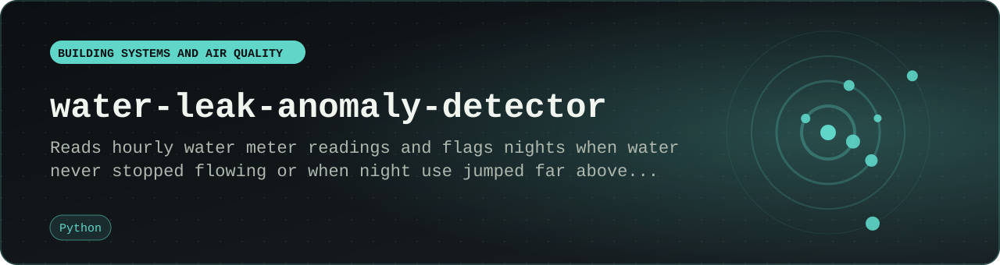
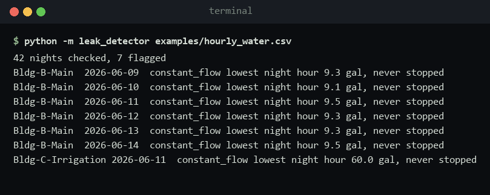

<p align="center"></p>

# water-leak-anomaly-detector

[](https://github.com/yassine2med/water-leak-anomaly-detector/actions/workflows/ci.yml)  

Reads hourly water meter readings and flags nights when water never stopped flowing or when night use jumped far above normal. Both are classic signs of a leak.



## What it is for

A building with no one inside should use almost no water between 1 and 5 in the morning. A running toilet, a broken irrigation line or a pipe leak shows up as flow in every one of those hours. Facility and sustainability teams can run this tool on exported meter data to find the meter and the date a leak started, before the monthly bill shows it.

## Install

```
git clone https://github.com/yassine2med/water-leak-anomaly-detector
cd water-leak-anomaly-detector && pip install -r requirements.txt
```

## How to use

| I want to | Command |
|---|---|
| Check a readings file | `PYTHONPATH=src python -m leak_detector examples/hourly_water.csv` |
| Check one meter only | `--meter Bldg-A-Main` |
| Change the night window (default hours 1 to 4) | `--night-start 0 --night-end 5` |
| Change the constant flow line (default 5 gallons per hour) | `--min-flow 50` |
| Change the surge multiple (default 3) | `--ratio 2` |
| Show help | `PYTHONPATH=src python -m leak_detector --help` |

The CSV has `timestamp,meter,gallons` with one row per meter per hour and ISO timestamps (see `examples/hourly_water.csv`: 14 days, 3 meters, invented data). Exit codes: 0 when nothing is flagged, 1 when something is flagged, 2 for a missing file or bad input.

Example:

```
PYTHONPATH=src python -m leak_detector examples/hourly_water.csv
```

Output:

```
42 nights checked, 7 flagged
Bldg-B-Main  2026-06-09  constant_flow lowest night hour 9.3 gal, never stopped
Bldg-B-Main  2026-06-10  constant_flow lowest night hour 9.1 gal, never stopped
Bldg-B-Main  2026-06-11  constant_flow lowest night hour 9.5 gal, never stopped
Bldg-B-Main  2026-06-12  constant_flow lowest night hour 9.3 gal, never stopped
Bldg-B-Main  2026-06-13  constant_flow lowest night hour 9.3 gal, never stopped
Bldg-B-Main  2026-06-14  constant_flow lowest night hour 9.5 gal, never stopped
Bldg-C-Irrigation 2026-06-11  constant_flow lowest night hour 60.0 gal, never stopped
```

Run the tests with `python -m pytest -q`.

## How it works

1. Each meter and date is summarised over the night window: lowest hour and mean.
2. A night with all hours present is kept. Nights with a missing hour are skipped.
3. constant_flow: the lowest night hour is at or above `--min-flow`, so water never stopped.
4. surge: the night mean is more than `--ratio` times the meter's median night mean (needs at least 3 nights).

## Limits

- It cannot tell a leak from planned use. In the sample, the Bldg-C-Irrigation flag on 2026-06-11 is a flag to check, not proof, because irrigation runs at night.
- A slow leak below `--min-flow` is invisible. Lower the value for meters with very low base use.
- The surge test needs history. With fewer than 3 nights it is skipped.
- Fixed night window for all meters, no weather and no occupancy data.

## License

MIT. Yassine Emhamed, 2026.
